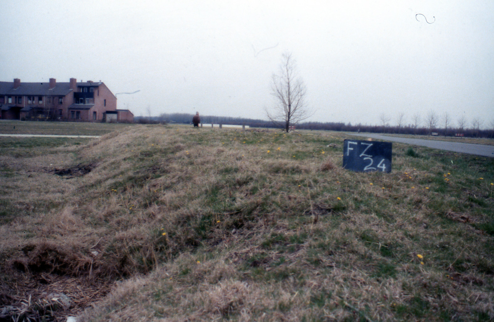

# Locatie

De locatie van deze verbeelding ligt in Almere in de provincie Flevoland.

```{r, echo=FALSE}
library(leaflet)
library(rmarkdown)

leaflet() |> 
  addTiles() |> 
  addMarkers(lng = metadata$long, lat = metadata$lat, popup = metadata$title)
```

# Historische achtergrond

De gemeente Almere beschrijft op haar website over het schip dat gevonden is op destijds kavel ZF24 alsvolgt:

> Begin 1980 werd bij de wijk De Meenten in Almere Haven een oud houten vrachtschip gevonden, vlakbij het Kerkhofpad. Het schip was van eikenhout. Het achterste deel was helemaal heel gebleven.
> In het wrak lagen een paar turven en een aardewerkschaal. De schaal had 2 oren en 3 pootjes, was zwart aan de buitenkant en werd misschien gebruikt om eten te koken. Het schip is ongeveer uit de eerste helft van de 16de eeuw, want er ligt een schelpenlaag overheen die uit ongeveer 1600 komt. Het schip is dus vóór die tijd gezonken. (Bron: <https://erfgoedhuis.almere.nl/archeologie/ingerichte-vindplaatsen/vindplaats-de-bomenboot-haven>)

Het schip is afgedenkt met een heuvel van grond, om te zorgen dat het beschermd blijft. Het schip op  is in 1995 opnieuw onderzocht door het toenmalige Centrum voor Scheepsarcheologie, Hierbij is de staat van het schip onderzocht en geconstateerd dat het schip in goede straat was.

{width=80%}


# Achtergrond project

> Na de vondst werd het wrak bedekt met aarde. Daardoor zie je nu een verhoging langs de weg. De weg maakte zelfs een bocht om het wrak te beschermen. In 2007 kwam er een kunstwerk op die plek (Bron: <https://erfgoedhuis.almere.nl/archeologie/ingerichte-vindplaatsen/vindplaats-de-bomenboot-haven>)


# Integratie in ontwerp of uitvoering

Het in 2007 geplaatste kunstwerk is gemaakt door kunstenaar Nout Visser (1944-2018). Het bestaat uit 22 jonge eikenbomen die samen de vorm van een omgekeerd schip vormen. Dit is geïnspireerd op de houten spanten van oude schepen en aanvankelijk waren de toppen samengebonden met touwen en latten.

{width=80%}

Sinds 2021 heeft Hetty Cramm het kunstwerk onder haar hoede als Kunstambassadeur (<https://kunstambassadeurs.nl/blog/2023/01/23/hetty-cramm-bomenboot/>)

{width=80%}

Op de onderstaande luchtfoto's is goed te zien hoe de bomen gegroeid zijn sinds 2016 (oudere luchtfoto,s zijn niet beschikbaar via het [National Georegister](https://nationaalgeoregister.nl/geonetwork/srv/dut/catalog.search#/metadata/a301ddc7-c26f-42d8-b367-509ae5ae47d0)).

:::: {.columns}

::: {.column width="49.5%"}

```{r, echo=FALSE}
leaflet() |>
  setView(lng = metadata$long, lat = metadata$lat, zoom = 20) |> 
  addWMSTiles(
    baseUrl = "https://service.pdok.nl/hwh/luchtfotorgb/wms/v1_0",
    layers = "2016_ortho25",
    options = WMSTileOptions(
      format = "image/jpeg",
      transparent = FALSE
    ),
    attribution = "PDOK Luchtfoto 2016 (25cm)"
  )

```

:::

::: {.column width="1%"}
:::

::: {.column width="49.5%"}

```{r, echo=FALSE}
leaflet() |>
  setView(lng = metadata$long, lat = metadata$lat, zoom = 20) |> 
  addWMSTiles(
    baseUrl = "https://service.pdok.nl/hwh/luchtfotorgb/wms/v1_0",
    layers = "2026_orthoHR",
    options = WMSTileOptions(
      format = "image/jpeg",
      transparent = FALSE
    ),
    attribution = "PDOK Luchtfoto 2026 (8 cm)"
  )

```
:::
::::


# Bronnen

## Opgravingsdata

Batavialand te Lelystad, Maritiem Archeologisch Depot, 2019, "Opgravingsdocumentatie scheepswrak ZF-24 / ZF24 (Zuidelijk Flevoland)", <https://doi.org/10.17026/DANS-X3Y-GP2R>, DANS Data Station Archaeology, V1

## Weblinks

<https://mass.cultureelerfgoed.nl/zf24>

<https://www.flevolanderfgoed.nl/home/erfgoed/zuidelijk-flevoland-2/scheepswrakken-3/zonder-titel-visser.html>

## Wikidata


